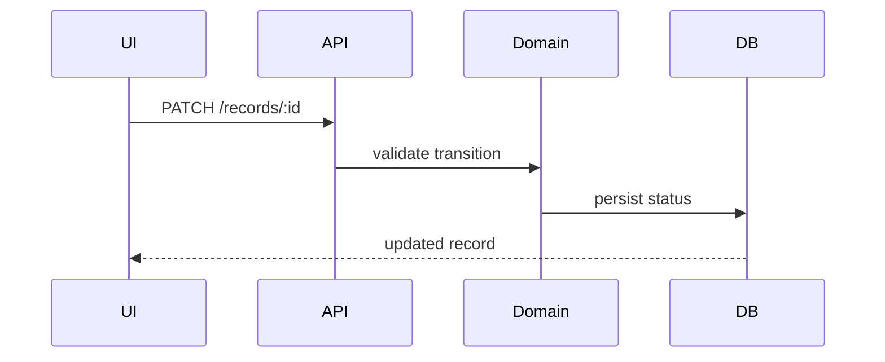

# Visual language for structure outlines

Read this file before drafting phase change outlines. A view earns its place only when it explains a relationship faster than prose. Choose the smallest useful view and place it immediately after a short sentence that says what the reader should notice.

## Choose by planning question

| Question | View |
|---|---|
| Which area owns the change? | Shallow file tree |
| Which UI modules, props, and state boundaries nest together? | Component tree |
| What calls what, and in what order? | Call tree or pseudocode |
| How do components or services exchange data? | Mermaid sequence or flow diagram |
| What changes in an existing shape? | Focused `diff` block |
| What is the complete new contract or type? | Language-specific or `text` block |
| How does a visual UI compare or lay out? | One focused HTML artifact |

Phase headings and view headings are optional. Order views by explanation: establish the contract or ownership first—whichever makes the rest legible—then show downstream consequences.

## File and ownership trees

Keep trees shallow. Group siblings beneath their shared directory and omit unchanged paths unless they orient the reader. Use `├──`, `└──`, and `│`.

```diff
 src/
 ├── records/
+│   ├── status.ts             + owns lifecycle rules
+│   └── status.test.ts        + proves allowed transitions
 ├── api/
+│   └── update-record.ts      ~ accepts the status contract
 └── ui/
+    └── RecordStatus.tsx      ~ renders and edits status
```

Inside a `diff` view:

- prefix additions and changed (`~`) shapes with `+`;
- prefix removals with `-`;
- prefix unchanged context with one space.

Notes should explain ownership or behavior, not merely repeat filenames.

Use a component tree when UI composition or state ownership is the point:

```tsx
<RecordPage> (apps/web/routes/record.tsx)
  useRecordStatus()              // server state boundary
  <RecordToolbar>
    <StatusControl />            // packages/ui
  <RecordTimeline />
```

## Runtime and state views

Use pseudocode for branching behavior:

```text
on(update status)
  validate transition
  persist status
  publish status-changed
  return updated record
```

Use a call tree when nesting or module boundaries are the point:

```text
updateRecord
  validateStatusTransition        (domain)
  recordsRepository.updateStatus  (persistence)
  statusEvents.publish            (integration)
```

Use Mermaid when interaction over time is the point:



Keep only participants and edges needed to explain the phase. The prose beside the diagram carries caveats and rationale.

Any focused existing shape can use diff notation. For example, show a changed call path without redrawing an entire architecture:

```diff
 updateRecord
   validateRecord
+  validateStatusTransition
   recordsRepository.save
-  notifyLegacyConsumer
+  statusEvents.publish
```

## Contracts and data shapes

Use a complete block for a new, compact target shape:

```ts
type RecordStatus = 'draft' | 'active' | 'archived'

interface RecordSummary {
  id: string
  status: RecordStatus
}
```

Use a diff for a focused change to an existing shape:

```diff
 PATCH /records/:id
 request
   id: string
+  status: RecordStatus
 response
   record: Record
+    status: RecordStatus
```

```diff
 records
   id                 uuid primary key
+  status             text not null       + lifecycle state
+  organization_id    uuid not null        ~ joins the lookup index
-  legacy_flag        boolean
```

Show constraints, nullability, compatibility behavior, or ordering only when they affect implementation sequencing.

## HTML artifact branch

Create HTML only for a visual UI, responsive layout, state comparison, or spatial concept that remains dense in Markdown/Mermaid. Create one focused, self-contained file:

```text
.agent-work/tasks/<task-slug>/show-me-<description>.html
```

The artifact must:

- use the product's evidenced colors, typography, spacing, and component language;
- use realistic labels, content, and states instead of filler;
- show both desktop and mobile behavior when responsive behavior matters;
- include visible headings or annotations that tie the view to the relevant phase;
- remain readable without external services; and
- contain only the interaction needed to explain the plan.

After writing it, verify the file opens and its key labels/states are present. Include its path with the outline. When the environment supports inline local-artifact rendering, render the HTML there; otherwise give the user the file path to open.

The HTML supplements the Markdown outline; the outline still states the ownership, target behavior, and validation contract.

## Visual audit

The visual set is complete when each view has one job, all depicted paths and symbols exist or are clearly marked as new, notation is internally consistent, and no file inventory is masquerading as an implementation plan.
