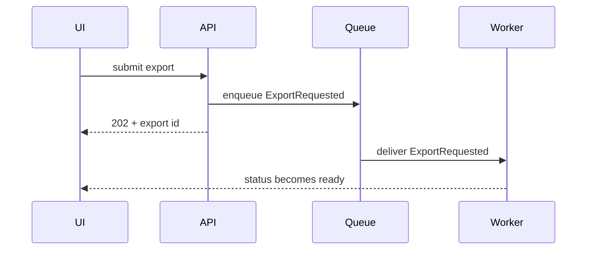

# System Design Reference

Read this reference when the System Design phase begins. Its completion bar is exhaustive: account for every concern below, recording applicable choices in the TDD and consciously ruling out the rest during analysis.

## Coverage checklist

### Boundary and ownership

- Identify the actors, services, applications, workers, stores, and external systems participating in the change.
- Mark which component owns each new behavior and datum.
- Show where requests, events, jobs, or user actions enter and where observable results leave.
- Explain the current arrangement and target delta together; emphasize unchanged boundaries only when they constrain the change.

### Contracts and state

- Define changed endpoints, RPCs, events, queue messages, storage schemas, and external API contracts.
- Specify the data each boundary accepts and returns, plus validation and compatibility expectations.
- Trace state transitions, ordering constraints, transaction boundaries, consistency expectations, and lifecycle ownership.
- Identify migrations, backfills, feature flags, dual-read/write periods, or version negotiation when required.

### Operational behavior

- Trace success and material failure paths, including retry, timeout, idempotency, partial completion, and recovery behavior.
- Define authorization, trust boundaries, sensitive-data handling, and abuse controls where the change crosses a security boundary.
- Identify logs, metrics, traces, alerts, and operator-visible state needed to distinguish healthy, degraded, and failed behavior.
- Describe rollout, compatibility window, rollback, and cleanup when deployment can expose mixed versions or persistent state.

### Verification implications

- Tie each changed boundary and material risk to an integration, contract, migration, end-to-end, or operational check.
- Keep test mechanics at design depth. Detailed test-file enumeration belongs in the structure outline.

## Choose the representation that exposes the decision

Use prose only for a decision that remains clearer without a visual. Place each representation immediately after its takeaway heading.

### Mermaid shows interactions and ordering

Use sequence or flow diagrams for control flow, data flow, asynchronous work, and component interactions.



The diagram should distinguish existing and new behavior in labels, annotations, or an adjacent sentence when both appear.

### Signatures show typed boundaries

Use the repository's language for high-level service or library contracts.

```text
requestExport(input: ExportRequest) -> ExportReceipt
getExportStatus(id: ExportId) -> ExportStatus
```

### Transport shapes show wire contracts

Use route, RPC, GraphQL, or message syntax that matches the system.

```text
POST /exports
  request:  { accountId: string, format: "csv" | "json" }
  response: { exportId: string, status: "queued" }
```

### Schemas show durable agreements

Use the project's ORM or schema language when it carries more relevant constraints than generic SQL.

```sql
CREATE TABLE exports (
  id          UUID PRIMARY KEY,
  account_id  UUID NOT NULL,
  status      TEXT NOT NULL,
  object_key  TEXT,
  created_at  TIMESTAMPTZ NOT NULL
);
```

## Complex-concept branch

When one decision combines structure, flow, annotations, or side-by-side alternatives beyond what Mermaid or plain text can communicate, create a focused HTML artifact at:

```text
.agent-work/tasks/<task-name>/diagram-<description>.html
```

Read [`artifact_template.html`](artifact_template.html) immediately before writing it. Keep the template's visual system, use realistic domain labels, and give the artifact one explanatory purpose. Link it beside the corresponding TDD section:

```markdown
[Open the export lifecycle diagram](diagram-export-lifecycle.html)
```

The complex-concept branch is complete when the HTML has valid document structure, the Markdown link resolves, and removing the artifact would materially reduce understanding of the decision.
