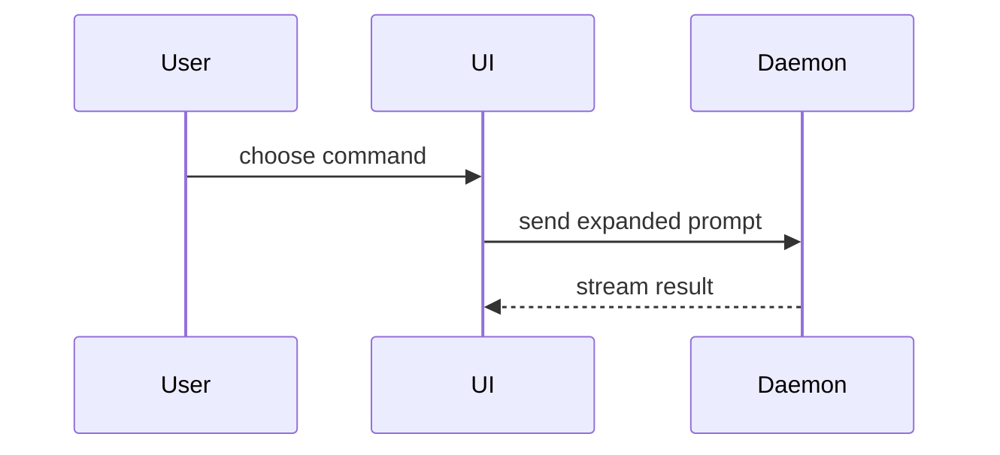

# Reviewer-map visual guidance

Use a visual only when it makes a relationship, sequence, or boundary materially faster to review than prose. Place it beside the claim it supports and keep only the changed calls, files, fields, components, states, and boundaries.

## Select the smallest useful view

| Review question | View |
| --- | --- |
| What changed in an existing shape? | A `diff` block shaped like that structure |
| What is the new target shape? | A complete language-specific or `text` block |
| Where did responsibilities move? | A shallow file tree |
| What calls what at runtime? | A call tree or sequence diagram |
| Which state and package boundaries matter in UI? | A component tree |
| How does data cross systems or phases? | A data-flow or control-flow diagram |
| What changed in storage or an API? | Focused SQL or request/response contracts |

Use one view when it answers the review question. Combine views only when each answers a different question.

## Focused change to an existing shape

Match diff notation to the subject rather than pasting source code mechanically.

```diff
 submitForm
   createSession
     persistPrompt
+    expandSkillMention
     launchAgent
-  navigateToSession
+  navigateToSession
+    subscribeToEvents
```

```diff
 src/
 ├── commands/
+│   └── show-me.ts       # expands the command
 ├── sessions/
-└── transport.ts
+└── transport/
+    ├── client.ts
+    └── stream.ts
```

## Complete target shape

Show the whole shape when most of it is new, omitted context would hide ownership or order, or the target is useful to copy.

```text
on save
  if content is unchanged
    return cached result
  write new content
  invalidate cache
  return fresh result
```

```tsx
<SessionPage> (apps/example/src/routes/session.tsx)
  useSessionEvents()
  <SessionToolbar>
    <RunSkillButton> (src/ui/actions)
  <SessionTimeline>
    <SkillResultCard> (src/ui/results)
```

## Contracts and data

Show only changed columns, relationships, and request/response fields. Annotate compatibility or migration behavior next to the affected shape.

```sql
sessions
  id          uuid primary key
  skill_name  text null          -- existing rows remain valid
  started_at  timestamptz
```

```json
POST /sessions
request  { "prompt": "...", "skill": "show-me" }
response { "sessionId": "...", "status": "queued" }
```

## Cross-boundary sequence

Use Mermaid when three or more participants or asynchronous transitions matter.



## Visual checks

- Every label, path, symbol, field, state, and edge exists in the final implementation.
- `+` and `-` communicate a real before/after change; unchanged context carries a leading space.
- The view fits one review concern and does not duplicate adjacent prose.
- Ownership, order, and module boundaries remain legible without hidden context.
- The PR description stays useful in plain GitHub Markdown without host-specific rendering.

The visual is complete when a reviewer can answer its one review question without opening unrelated files.
