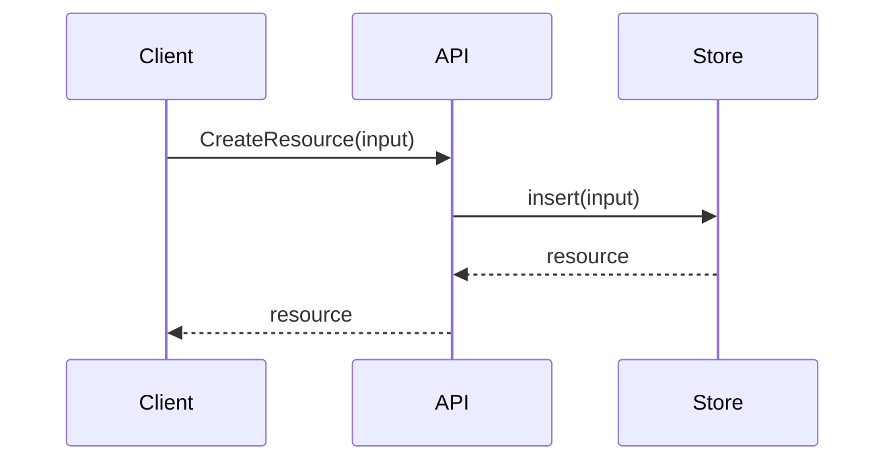

# TDD design and visual language

Read this reference before editing the TDD or creating a visual artifact. Apply every relevant rule to the resolved decision.

## Repaint a current design

Edit the TDD in place at its original path. Rewrite the smallest complete affected section, including adjacent material that would otherwise contradict it. The result should read as one design written on purpose:

- Use takeaway headings that state the decision or behavior, so the header hierarchy alone communicates the design.
- Keep paragraphs short and place each diagram, tree, signature, or snippet beside the prose it explains.
- Express the transition from existing behavior to proposed behavior inside the affected System Design narrative instead of creating a disconnected current-state/end-state appendix.
- Record durable rationale with the chosen design; omit interview transcripts, rejected-option logs, and revision chronology.
- Prefer the smallest set of views that lets a reviewer decide, align, and redirect implementation without loading the entire codebase.

## Apply document precedence

Resolve document conflicts in this order:

```text
TDD > PRD > design discussion > research > ticket/task
```

The higher document reflects decisions made after reading the lower one. Preserve a newer TDD decision over an older source. When new feedback changes product scope or UX, update the PRD and/or mockup so the documents agree; the TDD explains how to build the product behavior rather than duplicating the PRD.

When a PRD exists, cite it for product requirements, user flows, and mockups instead of restating them. When no PRD exists, derive requirements from the ticket/task and research, and make the functional behavior explicit enough for the technical design to stand alone.

## Keep the two design levels distinct

### System Design explains behavior across boundaries

Use it for:

- components/services and their responsibilities;
- end-to-end data and control flow;
- external interfaces and high-level API, RPC, event, method, or schema contracts;
- persistence boundaries, consistency, failure behavior, retry/idempotency, and observability;
- compatibility, migration sequence, rollout controls, and backout behavior.

Prefer sequence, flowchart, ER, or class diagrams and high-level contract signatures.

### Program Design explains the in-code shape

Use it for:

- entrypoints, call stacks, orchestration, and module ownership;
- frontend components, composables/state bindings, actions, and package boundaries;
- file responsibility changes;
- dependency-injection seams;
- concrete method/type signatures not already established in System Design;
- codebase patterns the implementation should follow, with verified locations and selective snippets.

Keep exhaustive file-by-file work breakdowns for the later structure outline or implementation plan.

## Choose the smallest useful view

### Call-stack tree

Use for backend, CLI, daemon, worker, or orchestration changes:

```text
entrypoint.ts
  handleRequest
    validateInput
    executeChange
      persistChange
      publishCommittedEvent
```

Use a `diff` fence only when additions/removals are the point. Prefer plain text when most of the tree is new.

### Frontend component tree

Use for UI changes and include production components, composables/state bindings, actions, and package seams:

```tsx
<ResourcePage> (apps/web/src/routes/resource.tsx)
  useResourceActions()
  <ResourceToolbar>
    <CreateResourceDialog> (packages/ui)
```

### File-tree diff

Use when file responsibility or a broad refactor is itself a design decision. Keep tree depth easy to scan and annotate responsibilities:

```diff
 src/resource
+├── resource-client.ts   # NEW — owns transport calls
~└── resource-route.tsx   # MODIFIED — wires the create action
```

### Dependency-injection map

Group dependencies by their receiver and name the seam each dependency provides:

```text
createResourceWorkflow
  receives resourceStore   -> persists resources
  receives eventPublisher  -> publishes only after commit
  receives clock           -> makes timestamps deterministic
```

### Signatures and schemas

Use concrete high-level types to make boundaries checkable. Include success and failure shapes when error behavior matters. Avoid pseudo-APIs that conflict with the codebase's transport or naming conventions.

## Mermaid branch

Use Mermaid for a focused relationship or sequence that plain text cannot reveal as quickly:

- `flowchart` for control/data flow and component boundaries;
- `sequenceDiagram` for interactions and ordering;
- `erDiagram` for persisted relationships;
- `classDiagram` for type boundaries.

Keep one diagram centered on one decision and use the exact terms from the prose and contracts.

````markdown

````

## HTML artifact branch

Use HTML when the decision needs layered code shape and data flow, annotations, or a side-by-side comparison that Mermaid/plain text cannot express cleanly.

1. Read `artifact_template.html` in this directory.
2. Create `.agent-work/tasks/<task>/diagram-<description>.html`.
3. Copy the template's complete `<style>` block unchanged and replace only the body marker with focused, realistic content.
4. Use semantic HTML first; use the supplied panels, grids, flow nodes, badges, metrics, and before/after utilities only where they clarify the decision.
5. Link the artifact immediately beside its explanation:

````markdown
[Open the design diagram](.agent-work/tasks/<task>/diagram-<description>.html)
````

If the current host supports inline previews, it may additionally preview the
same file; the ordinary Markdown link remains required.

Confirm the HTML has a doctype, language, charset, viewport, non-placeholder title, one `main.shell`, balanced tags, and no placeholder content before considering this branch complete.

## Propagate verification and delivery changes

For each revised decision, update every affected row or section in the TDD's verification and rollout material:

| Surface | Required design answer |
|---|---|
| Verification | Test level, scenario, fixture/harness, observable assertion, and failure proved |
| Observability | Signal, location, ownership, and threshold/diagnostic use |
| Migration | Data/config/schema ordering, backfill, mixed-version behavior, and validation |
| Rollout | Flag/cohort/stage, readiness gate, monitoring window, and expansion criterion |
| Backout | Reversible control, compatibility window, data consequence, and recovery verification |

When a surface is genuinely unaffected, preserve it and mark the working inventory `not applicable`; avoid adding empty ceremonial sections to the TDD.

## Cross-view coherence test

Before reporting an incorporated change, compare every repeated concept across prose and visuals:

- component, module, file, type, method, event, field, and endpoint names;
- caller/callee and producer/consumer direction;
- synchronous/asynchronous ordering and transaction boundaries;
- ownership of state, validation, retries, errors, metrics, and cleanup;
- old/new/removed status in diagrams and code/file diffs;
- verification assertions against the actual contract and failure modes;
- migration, rollout, and backout assumptions against compatibility constraints.

The edit passes when every affected concept has one consistent meaning across System Design, Program Design, product artifacts, verification, and delivery—and every unresolved point remains visibly unresolved.

## Markdown and artifact links

Use four backticks for an outer fence that demonstrates Markdown containing three-backtick fences. When the environment provides an optional artifact permalink, retain it for the turn handoff and resolved output. Use the local artifact path when no permalink exists.
