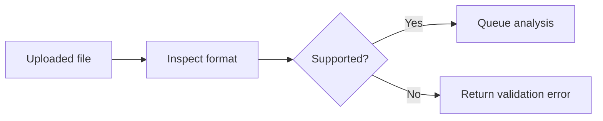
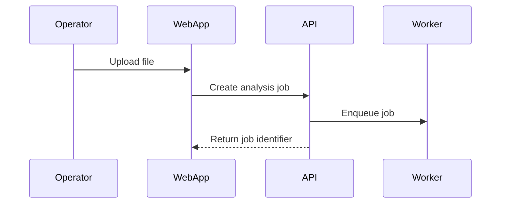
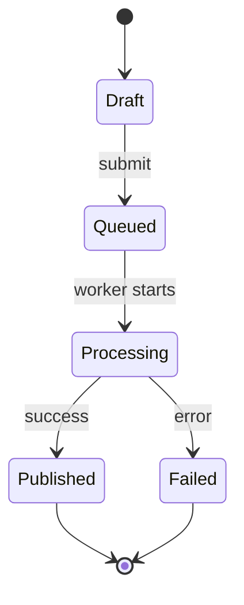

# Mermaid diagrams

Choose the diagram whose topology matches the question. Each example is directly renderable Mermaid syntax.

## Flowchart

Use a flowchart for branching control, data movement, dependencies, or component relationships where edges matter more than time.

- Choose `LR` for short pipelines and `TD` for branching depth.
- Give node identifiers simple ASCII names and put human-readable text in labels.
- Label decisions, non-obvious edge meanings, and data transformations.
- Use subgraphs only for real ownership, trust, process, or deployment boundaries.
- Keep a single dominant reading direction; split diagrams whose edges repeatedly cross or reverse it.

Check: every edge has a source and target, decision exits are labeled and exhaustive for the depicted scope, and boundary boxes do not imply unsupported ownership.

## Sequence diagram

Use a sequence diagram when the answer depends on time order, request/response pairs, concurrency, or handoffs among actors.

- Order participants to reduce crossing messages.
- Use solid arrows for requests or events and dashed arrows for responses unless the evidence requires another convention; explain any different distinction.
- Use `alt`, `opt`, `loop`, or `par` only when that branch is central to the question.
- Include responses, failures, and activation spans only when they clarify causality or lifetime.

Check: events read top to bottom, each message names an action or payload, and asynchronous or concurrent behavior is represented accurately.

## State diagram

Use a state diagram for lifecycle, event-driven transitions, guards, and terminal outcomes.

- Name states as durable conditions and transitions as events, optionally with `[guard]` and `/ effect`.
- Include initial, terminal, history, and composite states only when supported and relevant.
- Use a flowchart instead when the nodes are operations rather than durable states.

Check: every depicted transition is possible from its source state, guards are explicit where needed, and terminal states match observed or proposed behavior.

## Render check

Render the diagram with an available Mermaid renderer or Markdown preview. Resolve parser errors, clipped labels, excessive crossings, reversed reading direction, and unreadable density. Confirm that text labels preserve the meaning when theme colors change. Split a dense diagram into focused views rather than reducing text below ordinary reading size. If no renderer is available, report that syntax and visual rendering remain unchecked.
